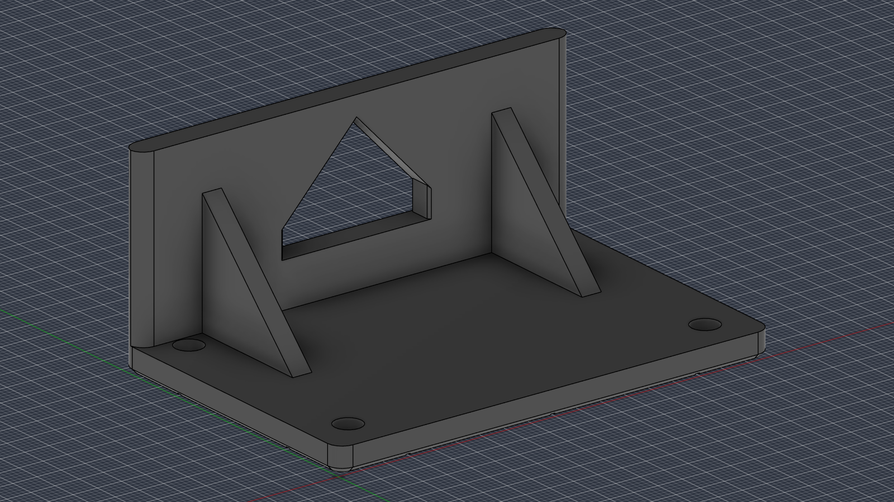
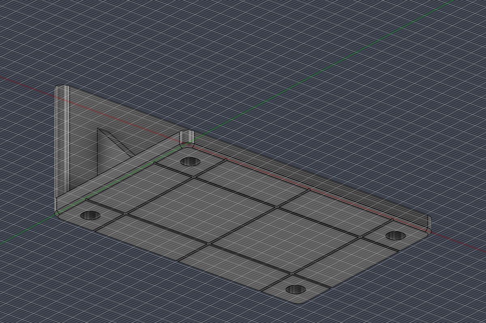

<div align="center">



# FusionKit

Typed, millimetre-based helpers for parametric Autodesk Fusion models, with FDM print checks on every body.

[](https://github.com/albertlis/FusionKit/actions/workflows/ci.yml)
[](https://github.com/albertlis/FusionKit/releases)


</div>

[Why](#why-fusionkit) · [With Claude](#what-it-looks-like-with-claude) · [Requirements](#requirements) · [Quick start](#quick-start) · [Troubleshooting](#troubleshooting) · [Example](#example) · [Modules](#modules) · [FAQ](#faq)

FusionKit sits between your code and the Autodesk Fusion API (`adsk`) and wraps it in helpers that take millimetres. It is tuned for FDM printing: the DfAM rules assume PETG, a 0.4 mm nozzle and 0.2 mm layers. `report` runs the DfAM rules on every body, with Z up as the print orientation. `printability.check_body` and `printability.sweep` are called explicitly, in a print orientation you choose. It ships as a Python package and as a Claude Code plugin.

## What it looks like with Claude

With the plugin installed, Claude runs the build loop. A typical request:

> Build a 90x60 mm PETG wall bracket with four M4 holes, printable without supports.

Then Claude:

1. Loads the `fusion-kit` skill. It holds the setup check, the build workflow and the verified Fusion gotchas.
2. Reads the helper index, `docs/fusion_kit_api.md`, and uses a helper wherever a row fits.
3. Writes the part script on `fusion_kit`. Every dimension is a User Parameter, and every timeline item gets a `label=`. It sends the script through the Fusion MCP `execute` tool, started by `run_part`.
4. Reads the last line of `report`. Suppose it ends with `dfam=1F/0W` and prints `DFAM_FAIL bed_chamfer: ...`. Claude adds the missing bed chamfer and runs the script again.
5. Tries to stop. The Stop hook (`dfam_guard`) blocks the stop while a `DFAM_FAIL` is open. It blocks once. The next stop passes, unless a new `DFAM_FAIL` came in.
6. Once `report` is green, calls the `CadSimplifier` agent. It reads the timeline and returns a ranked list of ways to build the same geometry with fewer steps. It does not edit the design.

This is a real `report` line from the demo bracket. It is not the output of the request above:

```
demo_bracket: bodies=1 lumps=1 bbox=90.0x60.0x40.0mm vol=42.139cm3 sketches=7/7 constrained design_timeline_unhealthy=0 timeline_unnamed=0 timeline_numbered=0 dfam=0F/0W
```

Most of the time lost with Fusion goes on rediscovering the same pitfalls in every session. The helper index, the API notes and the gotchas let Claude skip that search, so it needs fewer attempts. DfAM problems show up in the report before you slice, so fewer prints fail. Parameters make later changes cheap: you edit one value and the model rebuilds.

## Why FusionKit

The raw Fusion API works, but it has sharp edges. FusionKit encodes the fixes, so the next script starts from them.

| The problem with the raw API | What FusionKit does |
|---|---|
| **Module cache across runs.** Fusion keeps `sys.modules` between `execute` calls, so an edited helper silently runs its old code. | `loader.run_part` purges `fusion_kit.*` and the part package before every run. |
| **Sketch constraint jitter.** Dimensions on exactly shared coordinates trigger over-constraint errors and inferred H/V constraints. | `sketch.rect` and `sketch.param_poly` offset vertices safely and dimension them explicitly. |
| **Internal units are cm.** `evaluateExpression(expr, "mm")` also returns cm, and `.value` is cm. | Every public helper takes mm and converts at the boundary. |
| **Silent geometry loss.** A join after a hole cut closes the hole, and a chamfer on a concave edge does nothing without an error. | `report.report` prints bodies, lumps, bounding box and volume. `convex_edges` and `chamfer_greedy` probe edges before they fail quietly. |
| **Timeline noise.** Features named by Fusion (`Extrude3`) make the timeline unreadable and the design hard to edit. | `label=` is mandatory on every builder. `report` prints `timeline_unnamed`, which must be 0. |
| **Enum and expression pitfalls.** Typed enums are easy to misspell, and `round()` in expressions is not what Python does. | `enums` holds typed constants, and `expr` builds expressions with known behaviour. |
| **3D-printing failures found late.** Overhangs and thin walls show up after printing. | `dfam` runs FDM (PETG) rule checks on every body. `printability` checks overhangs in a print orientation you choose. |

The DfAM thresholds are FusionKit defaults; [`docs/dfam_guidelines.md`](docs/dfam_guidelines.md) gives each rule's source.

## What a run looks like

Every part script ends with `report.report(comp)`. It prints one summary line per component, then one line per DfAM finding. This is the summary from a live run of the demo bracket:

```
demo_bracket: bodies=1 lumps=1 bbox=90.0x60.0x40.0mm vol=42.139cm3 sketches=7/7 constrained design_timeline_unhealthy=0 timeline_unnamed=0 timeline_numbered=0 dfam=0F/0W
```

Check each field:

- `bodies` and `lumps`: a body count that drops after a join or cut means geometry was lost.
- `bbox` and `vol`: compare them with the numbers you expect from the parameters.
- `sketches=N/M constrained`: every sketch should be fully constrained.
- `design_timeline_unhealthy=0`: no feature has failed.
- `timeline_unnamed=0`: must be zero. `timeline_numbered` lists `x_1..x_n` names, which often mark a pattern that should have been a seed. Justify it or replace it.
- `dfam=<nF>F/<nW>W`, plus the `DFAM_FAIL` and `DFAM_WARN` lines. Each finding names its rule, as described below. A clean summary with a `DFAM_FAIL` line under it is not a pass.

## What it catches

FusionKit checks every body against FDM rules for PETG, in print orientation. FAIL findings make the Claude Code Stop hook block the session once. WARN findings are only printed. `printability.check_body` finds overhangs past 45°, hanging edges and floating points in a chosen print orientation, and `printability.sweep` ranks several orientations. You call these helpers yourself; `report` does not run them. These are the six rules you will meet most often:

- **`teardrop`**: a horizontal hole needs a pointed roof (a teardrop peak), so the top does not sag.
- **`seam_notch`**: a vertical hole needs a 0.3 mm V notch. The notch points +Y by default.
- **`bed_chamfer`**: edges on the bed face need a real chamfer, about 1 mm (0.5 mm in tight spots); a fillet fails.
- **`warp_grooves`**: a bed face wider than 35 mm needs relief grooves, 0.8 × 0.3 mm on a 30 mm pitch, to reduce warping.
- **`vertical_corner`**: a sharp vertical corner fails. Use a chamfer, or a fillet of 3 mm or more.
- **`petg_wall`**: a vertical wall between 0.9 and 1.6 mm fails. That band is two 0.45 mm perimeters, so the result depends on your slicer settings.

A body can opt out of a rule with the `dfam_skip` attribute and a written reason, for example `teardrop:no horizontal hole here`. The skip is printed, so it stays visible.

<div align="center">


<sub>Underside: 0.8 x 0.3 mm warp relief grooves on a 30 mm pitch, and the four mounting holes.</sub>
</div>

The full rule table, with sources and the rules that are advisory only, is in [`docs/dfam_guidelines.md`](docs/dfam_guidelines.md).

## Requirements

- **Autodesk Fusion**, with the Fusion MCP server enabled under **Preferences > General > API**. The free Personal plan works. Fusion has to stay open for every run.
- **Claude Code**, for the plugin path. No Python install is needed for it.
- **uv**, only for development (`uv sync --group dev`).
- **Python**: Fusion ships Python 3.14 (tested on 3.14.7). FusionKit depends only on the standard library and `adsk`. The offline tests run on 3.12 and 3.14.
- **Platform**: tested on Windows only. We have not tried macOS. The offline tests also run in CI on Ubuntu, but that is not a Fusion test.

Every change is logged in [CHANGELOG.md](CHANGELOG.md).

## Quick start

Open Autodesk Fusion. Then go to **Preferences > General > API** and enable the Fusion MCP server. Its endpoint is `127.0.0.1:27182/mcp` (plain HTTP, local only).

### 1. Install the Claude Code plugin

In Claude Code, add the marketplace and install the plugin:

```
/plugin marketplace add albertlis/FusionKit
/plugin install fusion-kit@fusionkit
```

No Python install is needed for this path. The plugin contents are listed under [Plugin contents](#plugin-contents). For the optional `fusion-cad` MCP server, see [Recommended MCP stack](#recommended-mcp-stack).

### 2. Run the demo

In Claude Code, ask:

> Run the FusionKit demo bracket

Create a new design document in Fusion first. The demo writes into the open document, so do not run it on a document you need to keep.

If the report ends with `dfam=0F/0W` and the bracket appears in Fusion, the setup works. Step names for partial runs: [demo README](examples/demo_bracket/README.md#run).

Nothing to configure: Claude fills in the plugin's install path when it loads the skill. Set `FUSIONKIT_PATH` only in these cases:

- **Dev clone.** You want Claude to use your own FusionKit checkout instead of the plugin copy. Set `FUSIONKIT_PATH` to that checkout's root, for example with `setx FUSIONKIT_PATH "C:\path\to\FusionKit"`, then restart Fusion. A running process does not see new environment variables.
- **Scripts run by hand.** A script you saved in Fusion's **Scripts and Add-Ins** dialog embeds the plugin path it was generated with. That path changes after a plugin update. Either point `FUSIONKIT_PATH` at a clone, or ask Claude to write the script again.

### Without the plugin

This is the manual path. It needs no Claude Code.

Clone the repo and sync the dev environment:

```bash
git clone https://github.com/albertlis/FusionKit.git
cd FusionKit
uv sync --group dev
```

Set `FUSIONKIT_PATH` to the FusionKit root, the directory that contains `fusion_kit/`. Then start every Fusion script through the loader:

```python
import os
import sys


def run(_context):
    fk = os.environ.get("FUSIONKIT_PATH", r"C:\path\to\FusionKit")
    for m in [m for m in sys.modules if m == "fusion_kit" or m.startswith("fusion_kit.")]:
        del sys.modules[m]
    sys.path.insert(0, fk)
    from fusion_kit.loader import run_part

    run_part(r"C:\path\to\my_bracket\my_bracket.py", "")
```

Send this through the Fusion MCP `execute` tool, or paste it into Fusion's **Scripts and Add-Ins** dialog. Do not put `import fusion_kit` at the top level of an `execute` script. The module cache keeps stale helpers between runs, and the loader prevents that.

Entry files must define `def run(_context)`. The loader expects the layout `<project>/<pkg>/<pkg>.py`, with optional `parts/` and `anim/` subfolders.

## Troubleshooting

- **MCP call fails with `ECONNREFUSED`.** The Fusion MCP server has stopped. Check that Fusion is open and that the API is enabled under **Preferences > General > API**. Then restart Fusion.
- **An edited helper still runs its old code.** Fusion keeps modules between runs. Start every script through `loader.run_part`, which purges `fusion_kit.*` first. `loader.py` is cached too: after you change it, restart Fusion.
- **Your `FUSIONKIT_PATH` is not seen.** This applies only when you set it, for example to a dev clone. A running process does not see new environment variables. Restart Fusion after `setx`.
- **`ModuleNotFoundError: fusion_kit` at the top of a script.** Move the import inside `run()`, after the `sys.path` insert.

## Example

This is a 60 x 30 x 4 mm plate with two bosses, patterned along the plate edge. Every dimension is a User Parameter, so changing `plate_length` in Fusion rebuilds the part. The file is `my_bracket/my_bracket.py`, run through `run_part` as shown above. The loader adds the FusionKit root to `sys.path` before it runs the entry file, so the top-level `fusion_kit` imports below are safe.

```python
import adsk.core
import adsk.fusion

from fusion_kit import component, features, report, sketch, user_params

PARAMS = {
    "plate_length": ("60 mm", "mm", "plate length along X"),
    "plate_width": ("30 mm", "mm", "plate width along Y"),
    "plate_thickness": ("4 mm", "mm", "plate thickness along Z"),
    "boss_diameter": ("8 mm", "mm", "boss diameter"),
    "boss_height": ("3 mm", "mm", "boss height above the plate"),
    "boss_edge_offset": ("10 mm", "mm", "boss centre to plate end"),
}


def run(_context: str) -> None:
    design = adsk.fusion.Design.cast(adsk.core.Application.get().activeProduct)
    user_params.ensure_params(design, PARAMS)
    comp = component.new_comp(design.rootComponent, "bracket")

    # Plate: rectangle dimensioned by parameters, anchored to the origin, extruded.
    plate_sk = sketch.new_sketch(comp, "xy", label="plate_sketch")
    bottom, right, _top, _left = sketch.rect(plate_sk, (0, 0, 0), (60, 30, 0))
    sketch.anchor(plate_sk, bottom.startSketchPoint)
    sketch.dim(plate_sk, bottom.startSketchPoint, bottom.endSketchPoint, "plate_length")
    sketch.dim(plate_sk, right.startSketchPoint, right.endSketchPoint, "plate_width")
    features.extrude(comp, features.profile(plate_sk), "plate_thickness", label="plate")

    # Boss: one seed, starting on the plate top (start_offset), joined to the plate.
    boss_sk = sketch.new_sketch(comp, "xy", label="boss_sketch")
    boss = sketch.circle(boss_sk, 10, 15, 4, diameter="boss_diameter")
    sketch.anchor(boss_sk, boss.centerSketchPoint, h="boss_edge_offset", v="plate_width / 2")
    boss_feat = features.extrude(
        comp,
        features.profile(boss_sk),
        "boss_height",
        op="join",
        start_offset="plate_thickness",
        label="boss",
    )

    # Repeat along the plate edge: qty 2, spacing = length - 2 * edge offset puts the second boss at the opposite end.
    features.pattern_rectangular(
        comp,
        [boss_feat],
        bottom,
        "2",
        "plate_length - 2 * boss_edge_offset",
        label="boss_row",
    )

    report.report(comp)
```

Two things to notice:

- Every dimension is a User Parameter. The helpers take expression strings, so the model stays editable.
- `label=` names each timeline item (`plate`, `boss`, `boss_row`, `plate_sketch`). That is why `report` shows zero unnamed items.

## Demo

[`examples/demo_bracket/`](examples/demo_bracket/README.md) is a printable PETG bracket built only from FusionKit helpers. What it shows:

- **Pattern holes:** one mounting hole, cut last so it does not close, repeated with `features.pattern_grid`.
- **Fillets and chamfers:** r 3 mm fillets on the outer vertical corners, 0.5 mm chamfers on the slot corners.
- **Bed chamfer:** a 46° chamfer on the bed edge, the `features.bed_chamfer` default, which keeps the face inside the 45° overhang limit.
- **Warp relief grooves** and a **pointed gable-roof slot** (46.8°, no flat ceiling).
- **Self-check:** `report` ends with no DfAM findings, and `printability.check_body(min_angle_deg=45)` passes.

Build steps: [demo README](examples/demo_bracket/README.md).

## Modules

| Module | What it is for |
|---|---|
| `sketch` | Dimensioned rectangles and circles, anchors, constrained profiles. |
| `features` | Extrude, revolve, fillet, chamfer, combine, mirror, patterns. Profiles picked by geometry. |
| `holes` | Simple, counterbore and countersink holes, screw slots, teardrop holes, seam notches. |
| `joints` | Dovetail profiles and joints with clearances. |
| `user_params`, `expr` | User Parameters and live expressions. |
| `loader`, `steps`, `timeline` | Clean module cache, stepped builds, timeline labels and health. |
| `component`, `view`, `enums` | Sub-components, view orientation, PNG screenshots, typed enums. |
| `report`, `printability`, `dfam` | Self-check line, probes, interference, overhangs, FDM rule scan. |

Every public helper is listed with its signature in [`docs/fusion_kit_api.md`](docs/fusion_kit_api.md). An offline test checks the format of every row.

## How we work with Claude

The working setup (Opus manager, Haiku workers, Adversary review loop, hooks) is described in [`docs/workflow.md`](docs/workflow.md).

## Recommended MCP stack

FusionKit runs scripts through Fusion's own MCP server. A second server is optional.

| Server | What it is for | Required |
|---|---|---|
| **Autodesk Fusion MCP** (`autodesk-fusion`, `127.0.0.1:27182/mcp`) | Built into Fusion, enabled under **Preferences > General > API**. Gives `fusion_mcp_execute` for scripts and document operations, `fusion_mcp_read` for screenshots, documents and API docs, and `fusion_mcp_update` for undo and redo. | Yes |
| **fusion-cad-mcp** ([github.com/Mfrostbutter/fusion-cad-mcp](https://github.com/Mfrostbutter/fusion-cad-mcp), MIT) | A typed tool layer in front of the Fusion MCP server. Adds measurement tools (`measure`, `bounding_box`, `volume`, `mass`), `interference_check`, `drive_joint` for moving parts, `audit_feature_health`, and knowledge lookups (`find_gotcha`, `find_pattern`, `find_api`). Optional, but the skill and `CadSimplifier` use it when present. | No |

Install `fusion-cad-mcp` by following its own README. The plugin's `.mcp.json` registers it as the server `fusion-cad`, which runs the command `fusion-cad-mcp`.

## Plugin contents

The Claude Code plugin (`.claude-plugin/plugin.json`, marketplace `fusionkit`) contains:

- **Skill:** `skills/fusion-kit/SKILL.md`, the setup check, build workflow, design-intent rules and tool routing.
- **Agent:** `agents/CadSimplifier.md`, a read-only design-intent reviewer. It returns a ranked recipe and does not change the design.
- **Hooks:** four hooks, wired in `hooks/hooks.json`.
- **MCP configuration:** `.mcp.json`, the Fusion and optional `fusion-cad` servers described above.

## Contributing

Read [CONTRIBUTING.md](CONTRIBUTING.md) first. It covers dev setup, tests, the Autodesk stub check, the helper checklist and commit rules.

For anything non-trivial, open an issue first. Offline tests and ruff run in CI on Ubuntu and Windows with Python 3.12 and 3.14. The hook self-tests run on Ubuntu with Python 3.12 only. A change that touches geometry also needs a live smoke run in Fusion, because the offline tests cannot show that Fusion accepts a generated operation.

## Documentation

- [`docs/fusion_kit_api.md`](docs/fusion_kit_api.md): the helper index, with signatures and the raw `adsk` calls each helper wraps. Read it before you write a part.
- [`docs/gotchas.md`](docs/gotchas.md): verified Fusion behaviours.
- [`docs/dfam_guidelines.md`](docs/dfam_guidelines.md): FDM and PETG rules, FAIL and WARN, with sources.
- [`CONVENTIONS.md`](CONVENTIONS.md): repository layout, naming and vocabulary.
- [`CLAUDE.md`](CLAUDE.md): the repository map and rules.

## Roadmap

Open work:

- More DfAM rules, and rules that are advisory only today.
- Assembly and joint helpers beyond the dovetail.

## License and attribution

FusionKit is licensed under the **FusionKit License 1.0**: source-available, noncommercial, with attribution required. The full text is in [LICENSE](LICENSE).

Projects built with FusionKit must credit it. For source repositories, put this line in the README:

```markdown
Built with FusionKit (https://github.com/albertlis/FusionKit)
```

## FAQ

**Does it work on the free Fusion Personal plan?**
Yes. The Fusion MCP server is available there, and FusionKit runs through it.

**Can I use it commercially?**
No, not under the FusionKit License 1.0. Commercial use needs a separate license from the author.

**Why not call `adsk` directly?**
You can, and for a one-off script that is fine. FusionKit pays off when the same problems keep coming back: the module cache, cm units, unnamed timeline items and printing failures found late.

**Does it need Claude?**
No. The loader, the helpers and `report` work without the plugin, which adds the skill, the agent and the hooks.

## Acknowledgements

- [fusion-cad-mcp](https://github.com/Mfrostbutter/fusion-cad-mcp) by Mfrostbutter, the optional typed tool layer described above.

## Disclaimer

FusionKit is an independent project. It is not affiliated with, endorsed by or sponsored by Autodesk, Inc. Autodesk and Fusion are trademarks of Autodesk, Inc. (Fusion 360 is also a trademark of Autodesk.) The software is provided as is, without warranty. Check every printed or machined part against its real requirements before you rely on it.
